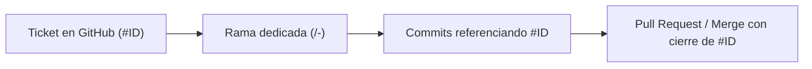

# Spec — Flujo de Trabajo Git y Tickets de GitHub

**Estado:** Vigente · **Última revisión:** 2026-10-29  
**Aplica a:** Todo requerimiento, nueva funcionalidad, refactor o corrección de bugs en el repositorio.

---

## 1. Principio Fundamental: 1 Requerimiento = 1 Ticket = 1 Rama

Para garantizar la trazabilidad total, orden y facilidad de auditoría en el ciclo de vida del software, todo desarrollo debe seguir esta cadena obligatoria:



---

## 2. Creación del Ticket (GitHub Issue)

Antes de iniciar cualquier cambio en el código:
1. Crear el Issue en el repositorio de GitHub (`ozcaredo89/allatyou-renting-hub`).
2. El ticket debe incluir:
   - **Título descriptivo:** Con prefijo `[Feat]`, `[Fix]`, `[Chore]` o `[Refactor]`.
   - **Contexto y objetivo:** Qué necesidad de negocio resuelve.
   - **Criterios de Aceptación:** Lista de verificación clara de cuándo se considera completado.
   - **Especificación técnica:** Rutas, componentes o contratos de API involucrados.

---

## 3. Nomenclatura de Ramas

Toda rama debe contener explícitamente el **número/ID del ticket** asignado en GitHub:

| Tipo | Patrón | Ejemplo |
|---|---|---|
| Nueva funcionalidad | `feat/<id>-<descripcion-kebab>` | `feat/4-expense-soat-tecno-renewal` |
| Corrección de error | `fix/<id>-<descripcion-kebab>` | `fix/12-overflow-cuotas-anticipos` |
| Tarea técnica / refactor | `chore/<id>-<descripcion-kebab>` o `refactor/<id>-...` | `chore/18-update-tailwind-config` |

> ⚠️ **Invariante:** Nunca crear ramas genéricas sin el ID del ticket (ej. `feat/soat` o `fixes-octubre` están prohibidos).

---

## 4. Convención de Commits

Todos los mensajes de commit deben referenciar el ID del ticket para que GitHub vincule automáticamente los cambios en la interfaz del issue:

- Formato recomendado:
  ```text
  feat(#<id>): <descripción concisa en imperativo / español>
  fix(#<id>): <descripción concisa>
  docs(#<id>): <descripción concisa>
  ```
- Ejemplos válidos:
  - `feat(#4): agregar endpoint para lectura por IA de vigencia en PDF de SOAT`
  - `fix(#4): corregir calculo de anio bisiesto en fecha sugerida de renovacion`
  - `docs(#4): actualizar spec de gastos con flujo opcional de SOAT y tecnomecanica`

---

## 5. Cierre y Trazabilidad

Al finalizar el desarrollo y verificar los criterios de aceptación:
1. El Pull Request o commit de merge debe incluir `Closes #<id>` o `Resolves #<id>`.
2. El issue en GitHub quedará automáticamente cerrado con su hilo histórico de commits y ramas vinculadas.
