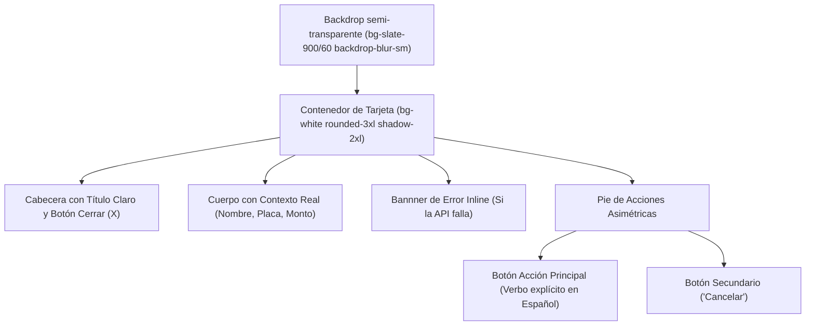

# SPEC: Estándar de UX para Modales, Diálogos y Confirmaciones

**Versión:** 1.0 (Noviembre 2026)  
**Ticket:** #36  
**Estado:** Vigente  
**Aplica a:** Todos los módulos del frontend (`web/src/`).

---

## 1. Invariante Cero: Prohibición de Diálogos Nativos del Navegador

> 🚫 **REGLA ESTRICTA:** Queda terminantemente prohibido el uso de `window.alert()`, `window.confirm()` y `window.prompt()`.

### Razones Técnicas y de Negocio:
1. **Ruptura de Identidad Visual:** Los diálogos nativos del navegador rompen la estética de AllAtYou (Tailwind CSS, esquinas redondeadas `rounded-2xl/3xl`, acentos en `emerald` y `slate-900`).
2. **Mensajes Mal Traducidos o Técnicos:** Suelen imprimir identificadores en mayúsculas crudas o inglés (ej: `¿Estás seguro de marcar esto como APPROVED?`), transmitiendo una sensación descuidada.
3. **Bloqueo del Hilo de Ejecución:** `alert()` y `confirm()` congelan el hilo síncrono de JavaScript del navegador, impidiendo animaciones y respuestas reactivas.
4. **Falsa Alarma en Móviles:** En Android y iOS, los diálogos del navegador se presentan como alertas de seguridad o phishing, asustando al usuario final o al administrador.

---

## 2. Anatomía Obligatoria de Modales y Diálogos

Todo modal o confirmación en AllAtYou debe construirse con componentes React nativos y cumplir con esta estructura:

### 2.1 Títulos y Textos (Tono Humano en Español)
* **Nunca:** *"¿Estás seguro de marcar esto como APPROVED?"* ni *"¿Desea continuar?"*.
* **Siempre:** 
  - Título: *"Aprobar postulación de vehículo"* o *"Confirmar publicación en catálogo"*.
  - Descripción: *"¿Confirmas que deseas marcar el **[Marca] [Línea] ([Placa])** de **[Propietario]** como aprobado para continuar el proceso?"*

### 2.2 Botones de Acción con Verbos Explícitos
* **Acción Principal:** Debe decir exactamente lo que ocurrirá:
  - `"Sí, aprobar"` (Estilo `bg-emerald-600` o `bg-slate-900`).
  - `"Sí, rechazar"` (Estilo `bg-red-600` o `bg-red-50 text-red-600`).
  - `"Sí, eliminar"` (Estilo `bg-red-600`).
  - `"Confirmar pago"` (Estilo `bg-emerald-600`).
  - ❌ Prohibido usar etiquetas genéricas como `"Aceptar"`, `"OK"` o `"Continuar"`.
* **Acción Secundaria:** Siempre `"Cancelar"`, con estilo neutro (`border border-slate-200 text-slate-600 hover:bg-slate-50`).

### 2.3 Manejo de Carga y Resiliencia
* Durante la mutación (`actionLoading === true`):
  - El botón principal debe quedar `disabled` y mostrar texto de progreso (ej. `"Aprobando..."`, `"Guardando..."`).
  - El botón `"Cancelar"` se deshabilita para evitar peticiones concurrentes o condiciones de carrera.
* Si ocurre un error en el fetch:
  - Mostrar un banner rojo inline (`bg-red-50 border-red-200 text-red-700`) dentro del propio modal.
  - **Jamás** disparar un `alert(error)`.

### 2.4 Ergonomía y Responsive Móvil
* **Backdrop blur:** `fixed inset-0 z-50 flex items-center justify-center bg-slate-900/60 p-4 backdrop-blur-sm`.
* **Cierre seguro:** Clic en el backdrop cierra el modal, pero el contenedor interno debe tener `onClick={e => e.stopPropagation()}`.
* **Scroll en pantallas pequeñas:** Contenedor con `max-h-[90vh] overflow-y-auto`.
* **Touch Target:** Todos los botones de acción deben tener una altura mínima de `py-2.5` a `py-3` (mínimo 44px táctiles) con esquinas `rounded-xl`.
